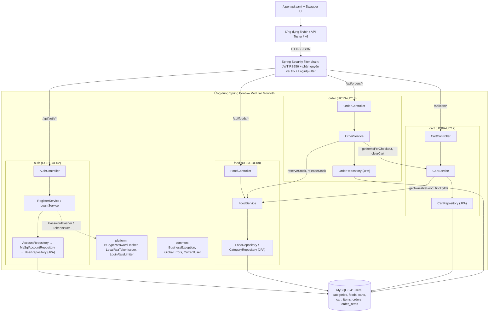

# ByteMe — Restaurant Ordering Backend

- **Swagger UI**: http://localhost:8080/swagger-ui/index.html
- **Đặc tả OpenAPI 3.0**: http://localhost:8080/openapi.yaml
- **Tài liệu kiến trúc & CSDL**: [docs/architecture-single-restaurant.md](docs/architecture-single-restaurant.md), [docs/database-design.md](docs/database-design.md), [docs/Project KTPM.md](<docs/Project KTPM.md>).

---

## 1. Bài toán và phạm vi

### 1.1. Boói cảnh bài toán
Dự án giải quyết bài toán đặt món và quản lý vận hành cho một nhà hàng:
- Phục vụ đồng thời 2 hình thức đặt món:
  - **Ăn tại chỗ (`DINE_IN`)**: Khách gọi món tại bàn, bắt buộc có thông tin số bàn (`tableNumber`), thanh toán tiền mặt (`CASH`) hoặc chuyển khoản (`BANK_TRANSFER`).
  - **Giao hàng tận nơi (`DELIVERY`)**: Khách đặt món giao về nhà, bắt buộc có tên, số điện thoại, địa chỉ nhận hàng, thanh toán khi nhận hàng (`COD`) hoặc chuyển khoản (`BANK_TRANSFER`).

### 1.2. Các đối tượng sử dụng
Hệ thống phân chia theo 3 vai trò độc lập:
- **Khách hàng (`CUSTOMER`)**: Đăng ký, đăng nhập, xem thực đơn, tìm kiếm món, quản lý giỏ hàng cá nhân, đặt đơn, xem danh sách đơn hàng của mình và hủy đơn khi đang chờ tiếp nhận (`PENDING`).
- **Nhân viên (`EMPLOYEE`)**: Xem danh sách đơn cần xử lý (lọc theo trạng thái/hình thức), xác nhận đơn (`PENDING → CONFIRMED`), cập nhật tiến độ chế biến (`PROCESSING`), giao hàng (`SHIPPING`), hoàn thành đơn (`COMPLETED`) hoặc hủy đơn (`CANCELLED`).
- **Quản trị viên (`ADMIN`)**: Quản lý toàn bộ danh mục thực đơn và món ăn (thêm mới, cập nhật giá bán, tồn kho, ngừng kinh doanh món). 

---

## 2. Nghiệp vụ chính

### 2.1. Quản lý Tài khoản & Xác thực (Auth — UC01, UC02)
- **Đăng ký tài khoản (`POST /api/auth/register`)**: Tiếp nhận `fullName`, `email`, `phone`, `password`, `confirmPassword`. Kiểm tra trùng lặp email/SĐT, mã hóa mật khẩu bằng BCrypt, tự động kích hoạt tài khoản vai trò `CUSTOMER`.
- **Đăng nhập & Cấp token (`POST /api/auth/token`)**: Xác thực thông tin đăng nhập, cấp JWT token với TTL 5.400 giây (90 phút).
- **Chống Brute-force**: Tích hợp cơ chế Rate Limiting in-memory tại tầng Filter: giới hạn tối đa 10 lần đăng nhập thất bại/email và 100 lần/IP trong cửa sổ 900 giây (15 phút).

### 2.2. Quản lý Thực đơn (Food — UC03 đến UC08)
- **Tra cứu công khai**: Khách hàng và người dùng chưa đăng nhập có thể xem danh mục, duyệt danh sách món ăn đang bán (`GET /api/foods`), xem chi tiết món (`GET /api/foods/{id}`) và tìm kiếm theo từ khóa kèm bộ lọc danh mục (`GET /api/foods/search?q=&categoryId=`).
- **Quản trị món ăn (Admin)**: Thêm món mới (`POST /api/foods`), sửa thông tin/giá bán/tồn kho (`PUT /api/foods/{id}`). Thao tác xóa món (`DELETE /api/foods/{id}`) áp dụng Soft Delete (chuyển trạng thái sang `INACTIVE` / ngừng bán). Giá tiền dùng kiểu số nguyên/thập phân chính xác `DECIMAL(15,2)`, không dùng số thực `float`/`double`.

### 2.3. Quản lý Giỏ hàng (Cart — UC09 đến UC12)
- Giỏ hàng định danh 1-1 theo `userId` của khách hàng (`CUSTOMER`).
- Lazy Creation: `GET /api/cart` khi khách chưa từng thêm món sẽ trả về giỏ rỗng `{ id: null, items: [] }` mà không tạo bản ghi rác trong CSDL. Bản ghi giỏ hàng chỉ được tạo tại lần thêm món đầu tiên (`POST /api/cart/items`).
- Hỗ trợ cập nhật số lượng món (`PUT /api/cart/items/{cartItemId}`) hoặc xóa món khỏi giỏ (`DELETE /api/cart/items/{cartItemId}`).

### 2.4. Quy trình Tạo đơn hàng đồng bộ (Order Checkout — UC13)
Toàn bộ thao tác checout (`POST /api/orders`) diễn ra trong một Database Transaction đoòng bộ duy nhất theo các bước:
1. Đọc giỏ hàng của khách; nếu chưa có giỏ hoặc giỏ rỗng, lập tức từ chối với lỗi `400 EMPTY_CART`.
2. Duyệt qua từng món theo thứ tự: kiểm tra món còn mở bán (`ACTIVE`) và còn đủ tồn kho (`stock >= qty`), thực hiện trừ tồn kho ngay lập tức (`stock = stock - qty`).
3. Tạo đơn hàng mới ở trạng thái `PENDING`.
4. Ghi nhận Snapshot bất biến của từng món ăn tại thời điểm mua (lưu cố định `food_name`, `unit_price`, `quantity` vào bảng `order_items`). Mọi thay đổi giá hoặc tên món của Admin sau này không ảnh hưởng đến đơn đã đặt. Tổng tiền đơn được tính tự động từ snapshot phía server; client không tự gửi giá hay danh sách món.
5. Làm sạch giỏ hàng (`DELETE cart_items`).
6. Nếu xảy ra bất kỳ lỗi nào (hết hàng, ngừng bán, lỗi hệ thống), toàn bộ giao dịch tự động rollback.

### 2.5. Vòng đời Trạng thái & Hủy đơn Hoàn kho (UC14 đến UC18)
```
          ┌────────────────────────────────────────────────────────┐
          │                                                        ▼
[PENDING] ──► [CONFIRMED] ──► [PROCESSING] ──(DINE_IN)──────────► [COMPLETED]
    │              │                │
    │              │                └──(DELIVERY)──► [SHIPPING] ──► [COMPLETED]
    │              │                                     │
    └──────────────┴─────────────────────────────────────┴──────► [CANCELLED]
```
- **Phân quyền chuyển trạng thái**:
  - `PENDING → CONFIRMED → PROCESSING`: Nhân viên xác nhận và đưa vào chế biến.
  - `PROCESSING → COMPLETED`: Áp dụng cho đơn ăn tại chỗ (`DINE_IN`).
  - `PROCESSING → SHIPPING → COMPLETED`: Áp dụng cho đơn giao hàng (`DELIVERY`).
- **Cơ chế Hủy đơn & Hoàn kho**:
  - Khách hàng chỉ được hủy đơn của chính mình khi đơn đang ở trạng thái `PENDING`.
  - Nhân viên có quyền hủy đơn khi đơn ở các trạng thái `PENDING`, `CONFIRMED` hoặc `PROCESSING`.
  - Khi đơn chuyển sang `CANCELLED`, hệ thống tự động hoàn trả tồn kho (`stock = stock + qty`) cho từng món trong đơn ngay trong cùng transaction hủy (áp dụng cả với món đã ngừng bán). Đơn đã hủy không thể phục hồi hoặc hủy lại lần hai.

---

## 3. Các vấn đề cần xử lý 

- **Concurrency:**
  - *Hiện trạng Phase 1*: Theo yêu cầu triển khai baseline cơ bản, hệ thống chưa dùng khóa bi quan (`SELECT ... FOR UPDATE`) hay khóa lạc quan (`@Version`). Do đó, hai checkout đồng thời có thể gặp hiện tượng Lost Update (cùng đọc tồn kho $S$ và cùng trừ kho, bán vượt tồn kho) dù `stock_quantity` không bị âm nhờ kiểm tra `stock >= qty`.
  - *Deadlock InnoDB*: Khi checkout, câu lệnh chèn vào `order_items` giữ Shared Lock (S-lock) trên bảng `foods` do ràng buộc Foreign Key, sau đó thao tác `UPDATE foods` trừ kho lại yêu cầu Exclusive Lock. Khi nhiều luồng cùng checkout các món giống nhau, InnoDB sẽ phát hiện deadlock và rollback một nhánh. Hệ thống đã xử lý bắt ngoại lệ này và trả về HTTP `409 CONCURRENT_UPDATE` để client gửi lại request.
  - *Định hướng Phase 2*: Triển khai khóa bi quan hoặc khóa lạc quan cho quá trình trừ kho và hoàn kho để ngăn chặn triệt để bán vượt kho và hủy trùng lặp.
- **Cơ chế Chống gửi trùng (Idempotency Key):**
  - Endpoint tạo đơn `POST /api/orders` hiện chưa hỗ trợ idempotency key; nếu client gửi lại request khi mạng chập chờn, request thứ hai gặp giỏ đã dọn và trả lỗi `400 EMPTY_CART`.
- **Giới hạn của Rate Limiter in-memory & Quản lý Token:**
  - Bộ đếm rate limit lưu trong bộ nhớ JVM sẽ bị reset khi ứng dụng khởi động lại và không chia sẻ được khi scale nhiều container backend (cần chuyển sang Redis khi mở rộng).
  - Token JWT hoàn toàn stateless; hệ thống hiện chưa có bảng thu hồi (blacklist/revocation) hay cơ chế refresh token/xoay vòng khóa.

---

## 4. Kiến trúc dự án và các tài liệu chi tiết

### 4.1. Sơ đồ kiến trúc tổng thể (Architecture Diagram)
Hệ thống được thiết kế theo mô hình Modular Monolith, phân tách độc lập các module (`auth`, `food`, `cart`, `order`):



### 4.2. Nguyên lý phân tầng & Quy tắc thiết kế

```
HTTP / JSON Request
       │
       ▼
[ Spring Security Filter Chain ] ── Xác thực JWT RS256, kiểm tra Rate Limit, phân quyền Role
       │
       ▼
[ Controller & DTO ]             ── Tiếp nhận HTTP, validate dữ liệu (@Valid), bóc tách CurrentUser
       │                            (Không chứa logic nghiệp vụ, không gọi trực tiếp Repository)
       ▼
[ Service (Nghiệp vụ) ]          ── Chứa toàn bộ quy tắc nghiệp vụ, ranh giới transaction (@Transactional)
       │                            (Độc lập hoàn toàn với Spring Web/Servlet và JPA/Hibernate trực tiếp)
       ▼
[ Repository & Entity ]          ── Spring Data JPA, đóng gói toàn bộ thao tác ORM và truy vấn SQL
       │
       ▼
[ CSDL MySQL 8.4 InnoDB ]
```

**Thiết kế kiến trúc:**
1. **Tầng Service độc lập** 
2. **Giao tiếp giữa các modu;e:** Các module `food`, `cart`, `order` chỉ tương tác với nhau thông qua Service và DTO công khai, không truy cập trực tiếp Entity hoặc Repository của module khác:
   - Cart gọi `FoodService` để kiểm tra món còn bán và lấy thông tin hiển thị.
   - Order gọi `CartService` để lấy món checkout / dọn giỏ và gọi `FoodService` để trừ kho / hoàn kho.

### 4.3. Docs

Xem ở `docs/`, `kaggle/`, `src/main/resources/static/` 

| Tài liệu | Đường dẫn | Nội dung và phạm vi |
| :--- | :--- | :--- |
| **Kiến trúc hệ thống** | [docs/architecture-single-restaurant.md](docs/architecture-single-restaurant.md) | Sơ đồ kiến trúc |
| **Thiết kế CSDL** | [docs/database-design.md](docs/database-design.md) | Chi tiết DB |
| **Đặc tả Use Cases** | [docs/Project KTPM.md](<docs/Project KTPM.md>) | Các usecase chi tiết |
| **OpenAPI** | [src/main/resources/static/openapi.yaml](src/main/resources/static/openapi.yaml) | Đặc tả API |
| **Stress Test** | [kaggle/results/phase1-baseline/README.md](kaggle/results/phase1-baseline/README.md) | Báo cáo stress test qua Kaggle |

### 4.4. Cấu trúc repo
```text
ByteMe/
├── compose.yaml                      # Cấu hình Docker Compose (MySQL 8.4 + Spring Boot backend)
├── Dockerfile                        # Multi-stage build (Temurin 21 JDK -> JRE runtime, non-root UID 10001)
├── pom.xml                           # Quản lý dependencies (Spring Boot 3.5.16, JPA, Security, ArchUnit...)
├── docs/                             # Tài liệu phân tích và thiết kế hệ thống
│   ├── Project KTPM.md               # Đặc tả chi tiết 18 Use Cases (UC01–UC18) & quy tắc nghiệp vụ
│   ├── architecture-single-restaurant.md # Thiết kế kiến trúc, sequence checkout & hủy đơn
│   ├── database-design.md            # Thiết kế CSDL (schema, quan hệ, khóa ngoại, chỉ mục)
│   └── security-report.md            # Báo cáo đánh giá bảo mật (ZAP scan, kiểm tra BOLA)
├── kaggle/                           # Kịch bản & kết quả kiểm thử tải (Load Testing) trên Kaggle
│   ├── dataset/                      # Schema DDL và dữ liệu seed mẫu cho môi trường đo tải
│   ├── script/                       # Notebook k6 benchmark (byteme_kaggle_benchmark.ipynb)
│   └── results/phase1-baseline/      # Báo cáo đo tải baseline phase 1 (biểu đồ latency, RPS, k6-summary)
├── scripts/                          # Scripts tiện ích phục vụ phát triển và kiểm thử
│   ├── generate-keys.py              # Sinh cặp khóa RSA (RS256) vào .local/ phục vụ ký JWT
│   ├── prepare-docker-keys.py        # Chuẩn bị bản sao khóa phân quyền cho container Docker
│   ├── issue-local-tokens.sh         # Sinh token JWT fixture để kiểm thử phân quyền local
│   └── test-endpoints.py             # Kịch bản kiểm thử tự động toàn bộ 18 API endpoint
├── zap/                              # Kết quả kiểm thử bảo mật tự động bằng OWASP ZAP
│   ├── be-anonymous/                 # Quét lỗ hổng API công khai
│   ├── be-authenticated/             # Quét lỗ hổng API sau đăng nhập (CUSTOMER, EMPLOYEE, ADMIN)
│   └── bola-ownership/               # Kiểm tra phân quyền sở hữu và truy cập chéo tài nguyên (BOLA)
└── src/
    ├── main/
    │   ├── java/org/example/
    │   │   ├── Application.java      # Entry point khởi chạy ứng dụng Spring Boot
    │   │   ├── auth/                 # Module Xác thực: đăng ký, đăng nhập, cấp JWT (UC01–UC02)
    │   │   │   ├── controller/       # AuthController, xử lý lỗi AuthErrors, AuthJsonAdvice
    │   │   │   ├── dto/              # Request/Response DTO cho đăng ký, đăng nhập, token
    │   │   │   ├── entity/           # Entity User, enum AccountStatus
    │   │   │   ├── repository/       # AccountRepository, UserRepository (JPA)
    │   │   │   └── service/          # RegisterService, LoginService, AuthValidation
    │   │   ├── food/                 # Module Thực đơn: xem, tìm kiếm, CRUD món ăn (UC03–UC08)
    │   │   │   ├── controller/       # FoodController
    │   │   │   ├── dto/              # FoodDto, FoodRequest
    │   │   │   ├── entity/           # Food, Category
    │   │   │   ├── repository/       # FoodRepository, CategoryRepository
    │   │   │   └── service/          # FoodService (quản lý món, kiểm tra & cập nhật tồn kho)
    │   │   ├── cart/                 # Module Giỏ hàng: quản lý dòng giỏ của khách (UC09–UC12)
    │   │   │   ├── controller/       # CartController
    │   │   │   ├── dto/              # CartDto, CartItemDto, AddToCartRequest...
    │   │   │   ├── entity/           # Cart, CartItem
    │   │   │   ├── repository/       # CartRepository (JPA)
    │   │   │   └── service/          # CartService (thêm, sửa, xóa, làm rỗng giỏ)
    │   │   ├── order/                # Module Đơn hàng: đặt đơn, cập nhật, hủy đơn (UC13–UC18)
    │   │   │   ├── controller/       # OrderController
    │   │   │   ├── domain/           # Enums nghiệp vụ: OrderStatus, OrderType, PaymentMethod
    │   │   │   ├── dto/              # CreateOrderRequest, OrderDto, OrderItemDto, StatusRequest...
    │   │   │   ├── entity/           # Order, OrderItem (chứa snapshot giá & tên món tại thời điểm đặt)
    │   │   │   ├── repository/       # OrderRepository
    │   │   │   └── service/          # OrderService (checkout trong 1 transaction, đổi trạng thái, hủy đơn)
    │   │   ├── common/               # Dùng chung: BusinessException, CurrentUser, ApiError, GlobalErrors
    │   │   ├── config/               # Cấu hình bảo mật: SecurityConfiguration (phân quyền vai trò)
    │   │   ├── platform/             # Hạ tầng kỹ thuật: BCryptHasher, LocalRsaTokenIssuer, LoginRateLimiter
    │   │   └── shared/api/           # Model giao tiếp liên module: AuthenticatedUser, Role
    │   └── resources/
    │       ├── application.yml       # Cấu hình Spring Boot (JPA, Jackson, Hikari, Timezone UTC...)
    │       ├── db/
    │       │   ├── schema.sql        # Định nghĩa 7 bảng CSDL MySQL và ràng buộc toàn vẹn
    │       │   └── seed.sql          # Dữ liệu mẫu (tài khoản demo, danh mục, món ăn ban đầu)
    │       └── static/
    │           └── openapi.yaml      # Đặc tả API OpenAPI 3.0 viết tay chuẩn hóa cho 18 use case
    └── test/java/org/example/
        ├── ArchitectureTest.java     # Kiểm tra tự động các quy tắc kiến trúc Clean Architecture (ArchUnit)
        ├── FoodServiceTest.java      # Unit test nghiệp vụ món ăn
        ├── OrderWebTest.java         # Test API đặt hàng và bảo mật MockMvc
        ├── DatabaseDesignTests.java  # Test tích hợp CSDL qua Testcontainers (MySQL thật)
        └── dev/LocalTokenCli.java    # CLI thử nghiệm tạo token fixture phục vụ phát triển
```

### 4.5. Công nghệ sử dụng
- **Backend**: Java 21 LTS, Spring Boot 3.5.16, Spring Security 6, Spring Data JPA, Hibernate ORM, Lombok
- **DB**: MySQL 8.4 InnoDB, connection pool HikariCP
- **Security**: JWT bất đối xứng (RS256), băm mật khẩu BCrypt, Rate Limiting in-memory
- **Build**: Maven Wrapper (Maven 3.9.11)
- **DevOps**: Docker, Docker Compose, Multi-stage image build
- **QA**: JUnit 5, MockMvc, Testcontainers, ArchUnit, OWASP ZAP, k6 load testing

---

## 5. Chạy nhanh và tài liệu API

### 5.1. Yêu cầu môi trường
- **Java**: JDK 21 trở lên
- **Docker & Docker Compose**: Để khởi chạy container MySQL và Backend

### 5.2. Hướng dẫn chạy

#### Bước 1: Tạo cặp RSA cho JWT
Ứng dụng sử dụng cặp khóa RSA đặt trong `.local` (đã gitignore) để ký và giải mã JWT:
```sh
python3 -m venv .venv
.venv/bin/pip install cryptography==50.0.2
.venv/bin/python scripts/generate-keys.py
```

#### Bước 2: Khởi chạy hệ thống

**Cách 1: Docker**
```sh
.venv/bin/python scripts/prepare-docker-keys.py
docker compose up --build -d
```
Nạp dữ liệu mẫu vào MySQL:
```sh
docker compose exec mysql sh -c 'mysql -u"$MYSQL_USER" -p"$MYSQL_PASSWORD" "$MYSQL_DATABASE" < /opt/byteme/seed.sql'
```

**Cách 2: Local JVM**
1. Chạy riêng container MySQL:
   ```sh
   docker compose up mysql -d
   ```
2. Chạy qua Maven Wrapper:
   - **Linux / macOS**:
     ```sh
     DB_URL=jdbc:mysql://localhost:3306/starter DB_USERNAME=starter DB_PASSWORD=local-development-only ./mvnw spring-boot:run
     ```
   - **Windows (PowerShell)**:
     ```powershell
     $env:DB_URL="jdbc:mysql://localhost:3306/starter"; $env:DB_USERNAME="starter"; $env:DB_PASSWORD="local-development-only"; .\mvnw.cmd spring-boot:run
     ```

#### Bước 3: Tài khoản thử nghiệm
Các tài khoản demo sau khi nạp `seed.sql`, pass chung là **`ByteMeDemo!2026`**:
- **ADMIN**: `admin@byteme.example` 
- **EMPLOYEE**: `huong.employee@byteme.example` hoặc `nam.employee@byteme.example` 
- **CUSTOMER**: `an.customer@byteme.example`, `binh.customer@byteme.example` 

Tạo nhanh token JWT fixture để kiểm tra phân quyền cục bộ:
```sh
bash scripts/issue-local-tokens.sh
```

### 5.3. Tài liệu API & Đặc tả Use Cases
- **Swagger UI**: `http://localhost:8080/swagger-ui/index.html`
- **Tài liệu OpenAPI**: `http://localhost:8080/openapi.yaml`

| UC | Method | Endpoint | Quyền hạn | Mô tả tóm tắt |
| :--- | :--- | :--- | :--- | :--- |
| **UC01** | POST | `/api/auth/register` | Công khai | Đăng ký tài khoản khách hàng mới |
| **UC02** | POST | `/api/auth/token` | Công khai | Đăng nhập và nhận accessToken |
| **UC03** | GET | `/api/foods?categoryId=` | Công khai | Xem danh sách món ăn đang bán |
| **UC04** | GET | `/api/foods/{id}` | Công khai | Xem chi tiết thông tin một món ăn |
| **UC05** | GET | `/api/foods/search?q=&categoryId=` | Công khai | Tìm kiếm món ăn theo từ khóa và danh mục |
| **UC06** | POST | `/api/foods` | ADMIN | Thêm món ăn mới vào thực đơn |
| **UC07** | PUT | `/api/foods/{id}` | ADMIN | Cập nhật thông tin món ăn, giá, tồn kho |
| **UC08** | DELETE | `/api/foods/{id}` | ADMIN | Ngừng kinh doanh món ăn (Soft delete) |
| **UC09** | GET | `/api/cart` | CUSTOMER | Xem giỏ hàng cá nhân hiện tại |
| **UC10** | POST | `/api/cart/items` | CUSTOMER | Thêm món ăn vào giỏ hàng |
| **UC11** | PUT | `/api/cart/items/{cartItemId}` | CUSTOMER | Cập nhật số lượng món trong giỏ |
| **UC12** | DELETE | `/api/cart/items/{cartItemId}` | CUSTOMER | Xóa một dòng món khỏi giỏ hàng |
| **UC13** | POST | `/api/orders` | CUSTOMER | Tạo đơn hàng mới từ giỏ hàng hiện tại |
| **UC14** | GET | `/api/orders/{orderId}` | CUSTOMER / EMPLOYEE | Xem chi tiết đơn hàng (khách hàng xem đơn của mình) |
| **UC15** | DELETE | `/api/orders/{orderId}` | CUSTOMER | Khách hủy đơn hàng của mình (chỉ khi PENDING) |
| **UC16** | POST | `/api/orders/{orderId}/confirm` | EMPLOYEE | Tiếp nhận và xác nhận đơn hàng |
| **UC17** | PUT | `/api/orders/{orderId}/status` | EMPLOYEE | Cập nhật trạng thái đơn (chế biến, giao hàng, hoàn thành, hủy) |
| **UC18** | GET | `/api/orders?status=&orderType=&page=&size=` | EMPLOYEE | Tra cứu danh sách đơn hàng cần xử lý có phân trang |

### 5.4. Lưu ý khi gọi API & Định dạng Dữ liệu
- **Tạo đơn hàng (`POST /api/orders`)**: Client không gửi danh sách món, đơn giá hay `userId`; server tự lấy từ giỏ hàng và JWT.
  - *Đơn ăn tại chỗ (`DINE_IN`)*: Bắt buộc gửi `tableNumber`; `paymentMethod` là `CASH` hoặc `BANK_TRANSFER`.
  - *Đơn giao hàng (`DELIVERY`)*: Bắt buộc gửi `recipientName`, `shippingPhone`, `shippingAddress`; `paymentMethod` là `COD` hoặc `BANK_TRANSFER`.
- **Giá trị Enum**: Bắt buộc gửi dạng tên chuỗi (`DINE_IN`, `CASH`, `COD`...); gửi dạng số hoặc chuỗi số sẽ bị từ chối với lỗi 400.
- **Phân trang (`GET /api/orders`)**: `page` mặc định 0, `size` mặc định 20 (tối đa 100), sắp xếp đơn mới nhất lên đầu. Khách xem mọi đơn của mình; nhân viên mặc định thấy PENDING/CONFIRMED/PROCESSING/SHIPPING (khi truyền `status` sẽ lọc được cả COMPLETED/CANCELLED).

---

## 6. Kiểm thử

Hệ thống được kiểm thử chi tiết (trust me bro)

### 6.1. Unit & Integration Tests (Testcontainers)
Kiểm thử toàn diện tầng nghiệp vụ, phân quyền MockMvc và CSDL MySQL thật thông qua Docker Testcontainers:
- **Linux / macOS**: `./mvnw test`
- **Windows**: `.\mvnw.cmd test`

*Bộ test bao gồm: [ArchitectureTest](src/test/java/org/example/ArchitectureTest.java) (kiểm tra quy tắc phụ thuộc kiến trúc bằng ArchUnit), [FoodServiceTest](src/test/java/org/example/FoodServiceTest.java), [OrderWebTest](src/test/java/org/example/OrderWebTest.java), [AuthIntegrationTest](src/test/java/org/example/AuthIntegrationTest.java).*

### 6.2. Kiểm thử kịch bản API tự động (Black-box Test)
Kiểm thử chuỗi kịch bản toàn diện trên toàn bộ 18 endpoint của hệ thống đang chạy (localhost:8080):
```sh
python -X utf8 scripts/test-endpoints.py
```
Kịch bản tự động kiểm tra đăng ký, đăng nhập, duyệt menu, giỏ hàng, đặt đơn ăn tại chỗ, đặt đơn giao hàng, luồng cập nhật trạng thái của nhân viên và hủy đơn hoàn kho.

### 6.3. Kiểm thử tải
- Test bằng k6 (50 VUs → 200 VUs → 500 VUs) qua Kaggle.
- Chi tiết cấu hình, biểu đồ độ trễ và báo cáo tóm tắt baseline: xem [kaggle/results/phase1-baseline/README.md](kaggle/results/phase1-baseline/README.md).

### 6.4. Đánh giá bảo mật 
- Hệ thóng được đnáh giá bằng OWASP ZAP 
- Kết quả không ghi nhận sai lệch phân quyền hay lộ lọt dữ liệu chéo người dùng: xem [docs/security-report.md](docs/security-report.md).
