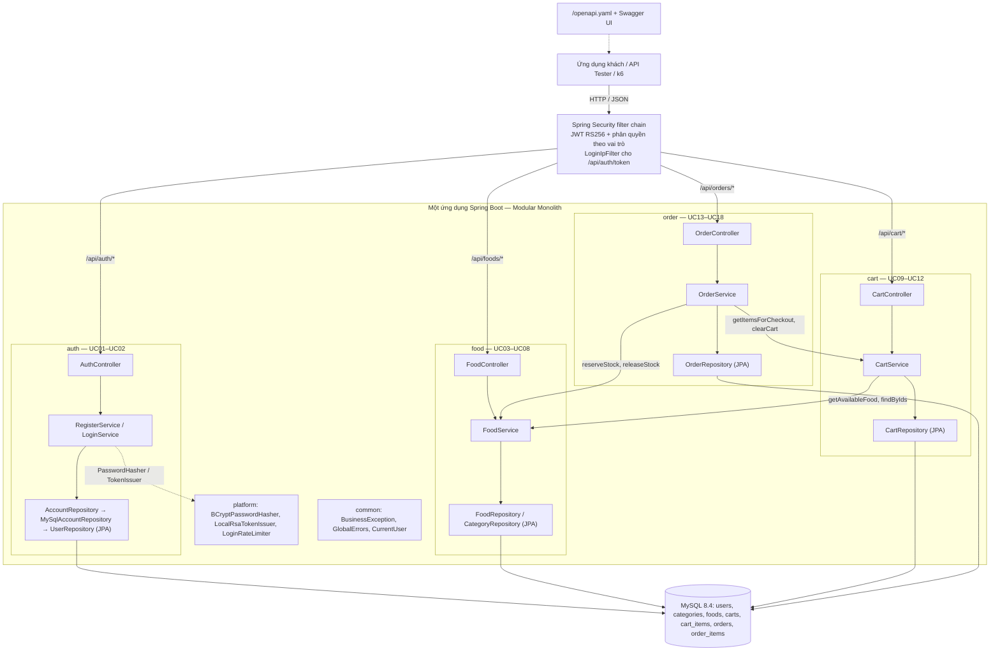
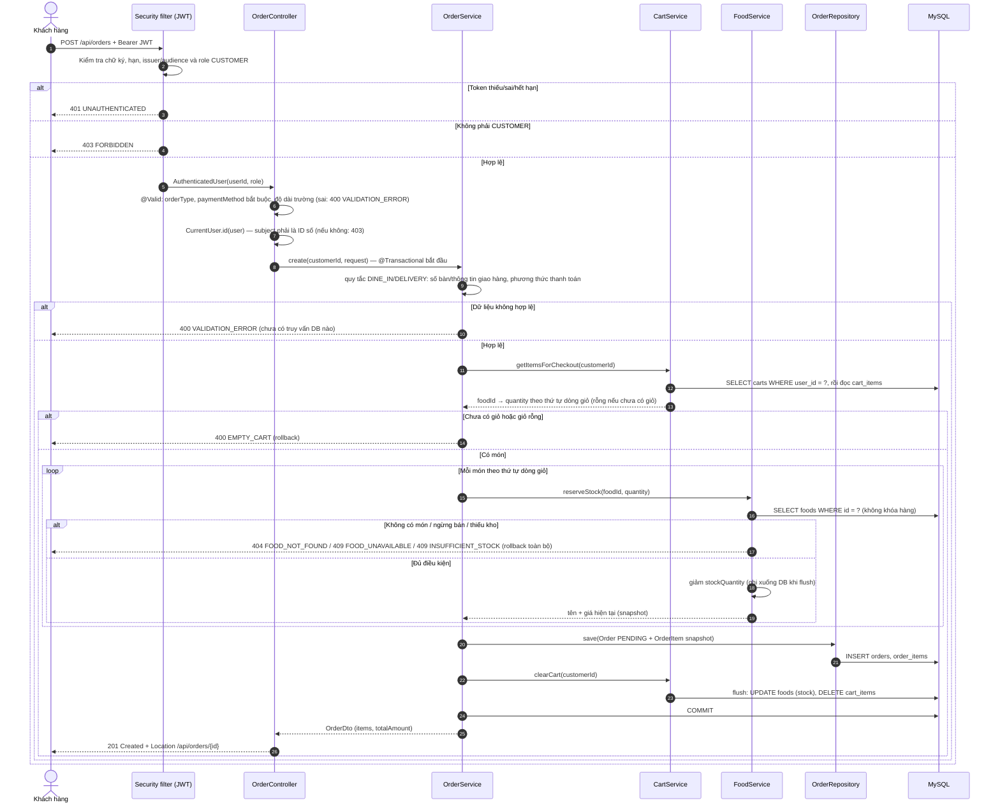
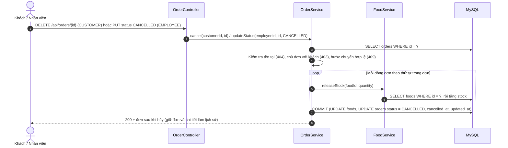
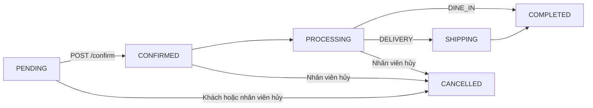

# ByteMe — Kiến trúc và checkout cho một nhà hàng

Tài liệu mô tả kiến trúc **đúng với code phase 1 hiện tại** cho một nhà hàng, gồm ăn tại chỗ (`DINE_IN`) và giao về nhà (`DELIVERY`). [Use case UC01–UC18](Project%20KTPM.md) xác định yêu cầu nghiệp vụ; [thiết kế database](database-design.md) xác định bảng và ràng buộc; [README](../README.md) tóm tắt kiến trúc và API.

## Phân tầng chung

Mọi module dùng cùng một kiểu phân tầng; quy tắc được `src/test/java/org/example/ArchitectureTest.java` (ArchUnit) kiểm tra tự động.

| Tầng | Package | Trách nhiệm | Được phép phụ thuộc |
| --- | --- | --- | --- |
| Bảo mật | `config.SecurityConfiguration`, `platform.security` | Xác thực JWT, phân quyền endpoint theo vai trò, giới hạn đăng nhập | Spring Security |
| API | `<module>.controller`, `<module>.dto` | Nhận/trả JSON, `@Valid` kiểm tra trường bắt buộc/độ dài (Food/Cart/Order), lấy user từ JWT (`CurrentUser.id`) | Service, DTO, enum của module, `shared.api`, Spring Web |
| Nghiệp vụ | `<module>.service` | Quy tắc nghiệp vụ (Order kiểm tra trường bắt buộc theo DINE_IN/DELIVERY và phương thức thanh toán), ranh giới transaction (`@Transactional`), ném lỗi nghiệp vụ (`BusinessException` ở Food/Cart/Order; `AuthFailure`, `DuplicateAccountException`, `AccountPersistenceException` ở Auth) | Repository/entity của chính module, service/dto của module khác. **Không** import Spring Web/HTTP, Servlet, Spring Data, JDBC, JPA, Hibernate |
| Truy cập dữ liệu | `<module>.repository`, `<module>.entity` | Spring Data JPA (CRUD, query method tự khai báo, `CartRepository.saveChanges`) | JPA/Hibernate, MySQL |
| Dùng chung | `common`, `shared.api` | `BusinessException`, `CurrentUser`, `ApiError`, `GlobalErrors`; `AuthenticatedUser`, `Role` | — |

Lỗi nghiệp vụ: service của Food/Cart/Order ném `BusinessException(type, code, message)`; `GlobalErrors` đổi `INVALID/FORBIDDEN/NOT_FOUND/CONFLICT` thành 400/403/404/409 với body `{status, code, message, path, fieldErrors}`. Auth giữ handler riêng `AuthErrors` cho `AuthFailure` và `DuplicateAccountException`.

## Sơ đồ kiến trúc

Mũi tên giữa các service là lời gọi Java trực tiếp. Các method được gọi đều là `@Transactional` với propagation mặc định (`REQUIRED`), nên khi `OrderService` gọi `CartService`/`FoodService` thì tất cả tham gia **cùng một transaction**: commit cùng nhau hoặc rollback cùng nhau.

Ranh giới giữa module:

- `CartItem` chỉ lưu `foodId`; Cart lấy thông tin món để hiển thị qua `FoodService.findByIds` và kiểm tra món còn bán qua `FoodService.getAvailableFood`.
- `OrderItem` chỉ lưu `foodId` cùng snapshot `foodName`/`unitPrice`; Order không dùng entity `Food`.
- Không module nào dùng `entity`/`repository`/`controller` của Food, Cart, Order từ bên ngoài module đó.

## Sequence UC13 — Tạo đơn hàng

Giá và tổng tiền do server tính từ dữ liệu món đọc trong transaction; client không gửi danh sách món, giá hay `userId`. Tổng tiền không lưu trên `orders` mà tính từ `order_items` (`OrderDto.totalAmount` = tổng `unitPrice × quantity`). Mọi lỗi trong transaction, kể cả lỗi hệ thống (500), đều rollback trước khi trả về.

Giỏ được tạo ở lần thêm món đầu tiên (`addToCart`). `GET /api/cart` khi chưa có giỏ trả `200` với `id: null`, `items: []` và không ghi gì vào database. Sửa/xóa dòng giỏ khi chưa có giỏ trả `404 CART_ITEM_NOT_FOUND`.

### Giới hạn phase 1

Theo đề bài phase 1 ("chỉ triển khai chức năng cơ bản, không cần tối ưu"), code hiện tại **không** dùng khóa hàng (`SELECT … FOR UPDATE`) hay khóa lạc quan (`@Version`), Hệ quả khi chạy đồng thời:

- Checkout đồng thời có thể bán vượt kho (lost update): hai transaction cùng đọc một giá trị tồn kho, cùng kiểm tra đủ kho rồi cùng ghi `stock - quantity`, nên tổng số đã bán vượt tồn kho; `stock_quantity` không bị âm vì service chỉ ghi khi tồn kho đọc được ≥ số lượng. Hai checkout cùng một giỏ không được tuần tự hóa: request sau có thể tạo đơn thứ hai hoặc lỗi thay vì nhận `400 EMPTY_CART`.
- Hai yêu cầu hủy cùng một đơn chạy đồng thời có thể cùng thấy trạng thái cũ và hoàn kho hai lần.
- Admin sửa món đồng thời với checkout có thể ghi đè tồn kho (lost update).
- Khách thêm món trong lúc checkout: số lượng cộng thêm vào một dòng giỏ đang được checkout có thể bị dọn mất mà không vào đơn.
- Checkout đồng thời trên cùng món dễ deadlock: insert `order_items` lấy khóa S trên hàng `foods` (FK), sau đó `UPDATE foods` cần khóa X. InnoDB rollback một transaction; `GlobalErrors` đổi `PessimisticLockingFailureException` thành `409 CONCURRENT_UPDATE` (client gửi lại). Sắp xếp thứ tự món không đủ để tránh trường hợp này.

Ràng buộc UNIQUE vẫn còn: hai lần thêm món đầu tiên đồng thời cùng tạo giỏ thì request vi phạm `carts.user_id` nhận `409 CONFLICT`. Các điểm trên để dành cho phase 2 (khóa hàng/khóa lạc quan hoặc cơ chế tương đương) và là mục tiêu đo trước/sau cải tiến trên Kaggle.

## Sequence hủy đơn (UC15, UC17)

`CANCELLED` là trạng thái cuối nên hủy lần hai (tuần tự) nhận `409 INVALID_ORDER_TRANSITION` và không hoàn kho lại. Phase 1 không khóa đơn, nên hai yêu cầu hủy **đồng thời** vẫn có thể hoàn kho hai lần (xem [Giới hạn phase 1](#giới-hạn-phase-1)). Hoàn kho áp dụng cả cho món đã ngừng bán.

## Trạng thái theo hình thức phục vụ

| Trạng thái hiện tại | Nhân viên được chuyển sang | Khách được chuyển sang |
| --- | --- | --- |
| PENDING | CONFIRMED, CANCELLED | CANCELLED |
| CONFIRMED | PROCESSING, CANCELLED | — |
| PROCESSING | CANCELLED; DINE_IN → COMPLETED; DELIVERY → SHIPPING | — |
| SHIPPING | COMPLETED | — |
| COMPLETED, CANCELLED | — | — |

Xác nhận lưu `confirmed_by`/`confirmed_at`; hủy lưu `cancelled_at`, giữ thông tin xác nhận nếu có; hoàn thành lưu `completed_at`. Thời gian do `OrderService` gán theo UTC (độ chính xác micro giây); thứ tự các mốc do service bảo đảm, schema không có CHECK. CASH chỉ cho DINE_IN, COD chỉ cho DELIVERY, BANK_TRANSFER cho cả hai. `tableNumber` là nhãn bàn lưu trong đơn; giai đoạn này chưa có đặt bàn hay quản lý bàn.
