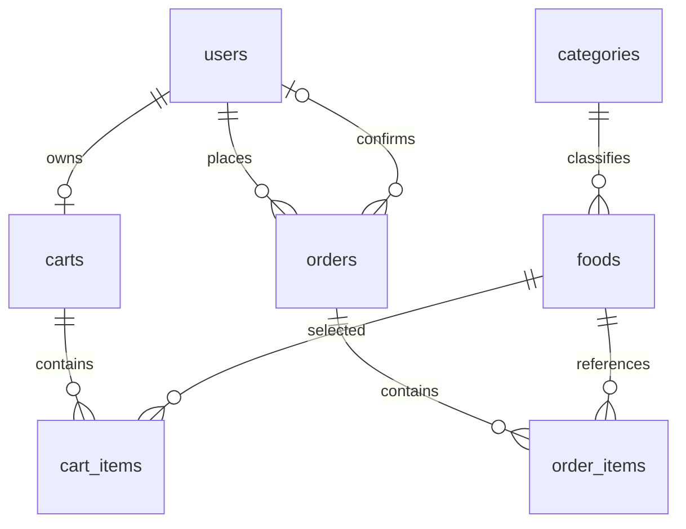

# Database ByteMe

MySQL 8.4/InnoDB cho [UC01–UC18](Project%20KTPM.md), phục vụ một nhà hàng.
Schema được tạo trực tiếp bằng SQL; dữ liệu mẫu là một script riêng, tùy chọn.

Phase 1 dùng schema tối giản: khóa chính, `NOT NULL`, giá trị mặc định, FK và
một số UNIQUE cần cho nghiệp vụ. Các bảng Food/Cart/Order không có CHECK, cột
generated, cột `version`, view hay index tối ưu; quy tắc dữ liệu do tầng service
và Bean Validation kiểm tra. Bảng `users` của Auth giữ nguyên định nghĩa.

## Bảng và quan hệ



FK cho phép tạo header đơn trước chi tiết. Một đơn hợp lệ phải có ít nhất một
`order_items` trước khi commit; database chưa tự bắt buộc điều kiện này.

| Bảng | Dữ liệu và ràng buộc chính |
| --- | --- |
| `users` | Họ tên, email/SĐT unique, BCrypt hash; một vai trò `CUSTOMER`/`EMPLOYEE`/`ADMIN`; trạng thái `ACTIVE`/`INACTIVE`/`LOCKED` |
| `categories` | Tên, mô tả; unique `name` (`uq_categories_name`) |
| `foods` | Một danh mục, tên, mô tả, ảnh, giá, tồn kho, trạng thái `ACTIVE`/`INACTIVE`; unique `name` toàn menu (`uq_foods_name`) |
| `carts` | FK người dùng; `user_id` unique nên mỗi tài khoản có tối đa một giỏ |
| `cart_items` | FK giỏ (xóa giỏ cascade)/món; số lượng; unique `(cart_id, food_id)` |
| `orders` | FK chủ đơn/người xác nhận; loại đơn, thông tin bàn/giao hàng, phương thức, trạng thái và thời gian |
| `order_items` | FK đơn/món; snapshot tên, đơn giá, số lượng; unique `(order_id, food_id)` |

Định nghĩa đầy đủ: [schema.sql](../src/main/resources/db/schema.sql).

## Quy tắc dữ liệu

- Tên món/danh mục unique, không phân biệt hoa thường (collation `utf8mb4_0900_as_ci`),
  có phân biệt dấu. Với món, `FoodService` bỏ khoảng trắng đầu/cuối trước khi lưu và
  kiểm tra trùng tên (`existsByName`); danh mục chỉ được nạp từ `seed.sql`. Một món thuộc một danh mục và có một giá dùng cho
  cả hai loại đơn.
- Giá > 0 và tồn kho ≥ 0 khi Admin tạo/sửa món được Bean Validation kiểm tra
  (`@Positive`, `@Min(0)`), database không có CHECK tương ứng.
- `stock_quantity` là số suất còn có thể đặt, do Admin cập nhật. `ACTIVE` nhưng
  tồn kho bằng 0 nghĩa là đang bán nhưng hết suất. Thêm vào giỏ chưa giữ hàng;
  checkout trừ kho, hủy hợp lệ hoàn kho.
- Tiền dùng `DECIMAL(15,2)` và Java `BigDecimal`. Chưa có phí, thuế hoặc giảm giá.
- Không lưu tổng riêng trong `orders`. Tổng đơn tính từ snapshot chi tiết
  (`unit_price * quantity`), không lấy giá hiện tại trong `foods`; API trả
  `OrderDto.totalAmount`.
- Snapshot tên/giá món và thông tin phục vụ giữ lịch sử khi hồ sơ/menu thay đổi.
  Chi tiết đơn không được chỉnh sửa sau checkout; schema chưa tự cấm sửa/xóa snapshot.
- Timestamps dùng `DATETIME(6)` theo UTC.

Đọc tổng đơn bằng SQL:

```sql
SELECT o.id, o.status, COALESCE(SUM(oi.unit_price * oi.quantity), 0) AS total_amount
FROM orders o
LEFT JOIN order_items oi ON oi.order_id = o.id
GROUP BY o.id, o.status;
```

## Hình thức phục vụ

`order_type` bắt buộc ghi rõ, không có default. `OrderService` kiểm tra các tổ hợp sau
(database không có CHECK):

| Loại đơn | Thông tin bắt buộc | Trường phải null | Thanh toán |
| --- | --- | --- | --- |
| `DINE_IN` | `table_number` không rỗng, tối đa 20 ký tự | Người nhận, SĐT, địa chỉ giao hàng | `CASH`, `BANK_TRANSFER` |
| `DELIVERY` | Người nhận, SĐT và địa chỉ không rỗng | `table_number` | `COD`, `BANK_TRANSFER` |

Số bàn là nhãn văn bản; chưa quản lý bàn/đặt chỗ. Phương thức thanh toán ghi nhận
lựa chọn, chưa xác nhận giao dịch thanh toán.

## Trạng thái đơn

Luồng chung: `PENDING → CONFIRMED → PROCESSING`.
Đơn tại chỗ đi tiếp `COMPLETED`; đơn giao hàng đi `SHIPPING → COMPLETED`.
`OrderService` cấm `SHIPPING` cho `DINE_IN`.

| Trạng thái | Người/thời điểm xác nhận | `cancelled_at` | `completed_at` |
| --- | --- | --- | --- |
| `PENDING` | Cả hai null | Null | Null |
| `CONFIRMED`, `PROCESSING`, `SHIPPING` | Cả hai bắt buộc | Null | Null |
| `COMPLETED` | Cả hai bắt buộc | Null | Bắt buộc |
| `CANCELLED` | Cả hai null hoặc cùng có giá trị | Bắt buộc | Null |

Các mốc không trước `created_at`; hủy/hoàn thành không trước xác nhận nếu có.
`OrderService` gán các mốc và kiểm tra bước chuyển; database không tự kiểm tra.
Khách chỉ hủy `PENDING`; nhân viên có thể hủy `PENDING`/`CONFIRMED`/`PROCESSING`.
Đơn hủy sau xác nhận giữ thông tin xác nhận.

## Toàn vẹn và xóa

FK dùng `RESTRICT` để bảo vệ dữ liệu liên quan; riêng xóa giỏ cascade các dòng giỏ.
`DELETE /api/foods/{id}` luôn chỉ chuyển món sang `INACTIVE` (xóa mềm), không xóa vật lý.
Hủy đơn cập nhật `CANCELLED`, giữ header và chi tiết.

Unique/FK không tự kiểm tra vai trò người xác nhận hoặc quyền sở hữu.
Checkout dùng một giao dịch chung cho đơn, chi tiết, kho và dọn giỏ; hủy dùng
một giao dịch chung cho trạng thái và hoàn kho. Vi phạm UNIQUE (ví dụ hai lần
thêm món đầu tiên đồng thời cùng tạo giỏ) trả `409 CONFLICT`.

Ngoài khóa chính, UNIQUE và index InnoDB tự tạo cho FK, phase 1 không thêm index
tối ưu. Lọc món, tìm kiếm `%keyword%` và danh sách đơn có thể cần quét bảng;
FULLTEXT, cache hay index nâng cao để dành cho phase 2.

### Giới hạn phase 1

Phase 1 không khóa hàng (`SELECT … FOR UPDATE`) và không dùng khóa lạc quan
(`version`). Vì vậy:

- Checkout đồng thời có thể bán vượt kho do lost update: hai giao dịch cùng đọc một
  tồn kho rồi cùng ghi `stock - qty`. `stock_quantity` không bị âm vì service kiểm tra
  `stock >= qty` trước khi ghi giá trị tuyệt đối.
- Hai yêu cầu hủy cùng một đơn chạy đồng thời có thể hoàn kho hai lần.
- Admin sửa món đồng thời với checkout có thể ghi đè tồn kho.

Các điểm này để dành cho phase 2 và là mục tiêu đo trước/sau cải tiến.

## Khởi tạo và dữ liệu mẫu

[seed.sql](../src/main/resources/db/seed.sql) nạp 8 tài khoản, 6 danh mục, 18 món, 5 giỏ, 6 dòng giỏ,
8 đơn và 16 chi tiết. Có cả hai loại đơn và đủ sáu trạng thái.
Mật khẩu mẫu `ByteMeDemo!2026`, lưu BCrypt. Các đơn lịch sử có snapshot giá cũ.

Docker khởi tạo schema khi MySQL tạo volume mới. Với database có sẵn, có thể
chạy `schema.sql` bằng MySQL client: script tạo bảng còn thiếu, không tự
thay đổi cấu trúc bảng đã tồn tại (database tạo từ schema cũ cần tạo lại volume). Thay đổi cấu trúc sau này dùng SQL thủ công.
Seed chạy trong một giao dịch, chỉ dùng cho database rỗng: chạy lại sẽ lỗi trùng khóa
chính và không nạp thêm gì. Seed không tự nạp khi backend khởi động. Xem lệnh nạp seed trong [README](../README.md).

Chạy `./mvnw test` (cần Docker) để kiểm tra trên MySQL riêng qua Testcontainers.
